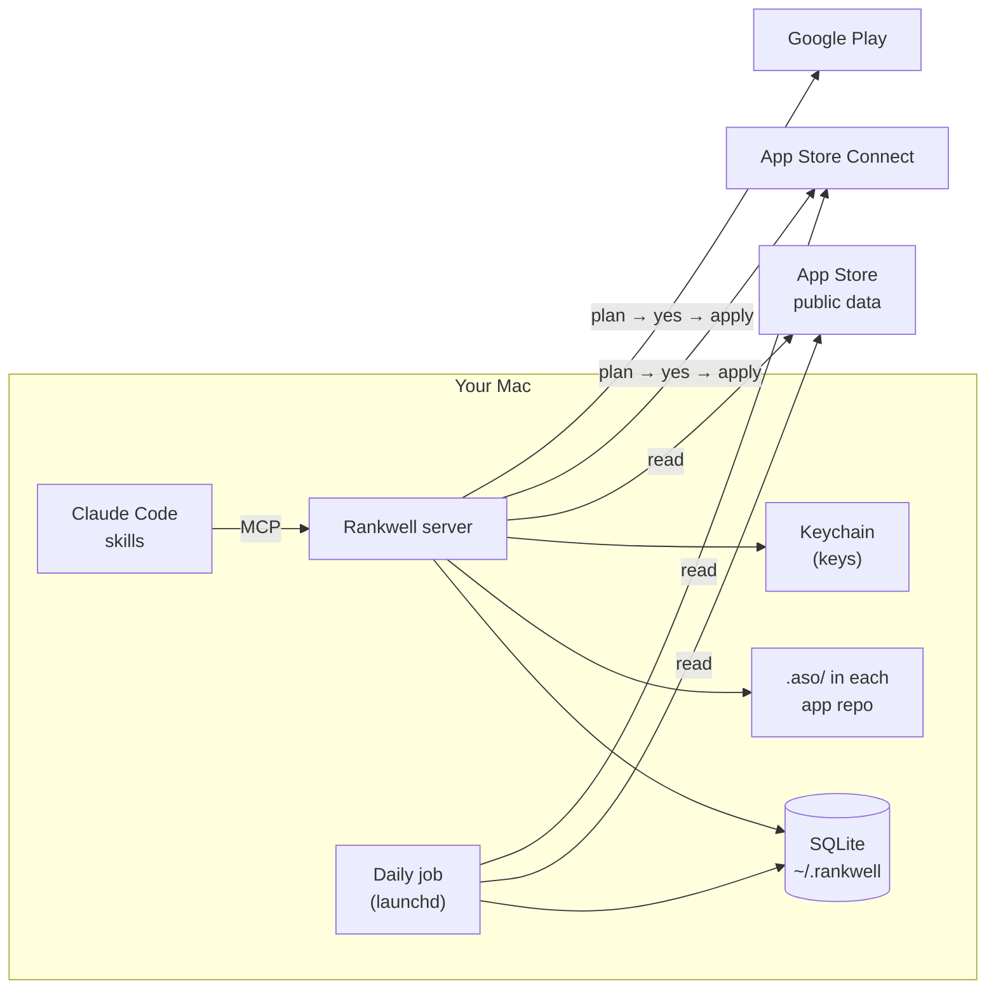

<div align="center">

# Rankwell

**App Store Optimization and release automation, inside Claude Code.**

Know where your app stands, decide what to change, and ship the change, from the same chat where you write
the code.

[](https://github.com/AkashShahriar55/rankwell/actions/workflows/ci.yml)
[](LICENSE)


[Install](#install) · [What you can ask](#what-you-can-ask) · [How it works](#how-it-works) ·
[Safety](#safety) · [Command line](#command-line) · [FAQ](#faq)

</div>

---

Most ASO tools are dashboards you have to remember to open, and most release tools stop at the upload.
Rankwell is a [Claude Code](https://docs.anthropic.com/en/docs/claude-code) plugin that does both jobs where
you already work:

- **It watches.** A daily job tracks keyword ranks, your listing and your competitors' listings, reviews,
  category charts and App Store Connect analytics, and keeps the history on your Mac.
- **It advises with evidence.** Gap reports, keyword research and listing copy come with the numbers behind
  them and cite the ASO rule they follow.
- **It ships.** Listing changes, screenshots, review replies, builds, submissions and Google Play releases go
  out through a plan you approve in chat: current value → new value, then your yes.
- **It remembers.** Decisions, experiments and progress live in a `.aso/` folder in each app repo, so the
  next session starts where the last one stopped.

> **Status:** early development (0.x). iOS App Store and Google Play. macOS only.

## Example

```text
You:      how is NorthStar doing?

Rankwell: NorthStar · last 7 days (US)

          | keyword            | rank | change | trend    |
          |--------------------|------|--------|----------|
          | habit tracker      |   38 |    +9  | ▁▂▃▃▅▆▇  |
          | streak app         |   12 |    +2  | ▃▃▄▄▅▅▆  |
          | daily goals        |    – |   out  | ▆▅▃▂▁    |

          Page views 1,204 (+14%) · conversion 31% · rating 4.6 (128)
          A competitor changed its subtitle to "Habit Tracker & Streaks" on Tuesday.

          Next: 1. Answer the 2 new one-star reviews  2. Move "streaks" into the subtitle
                3. Close experiment EXP-004 (due today)
```

*Illustrative output for a sample app.*

## What you can ask

| You say | What happens |
|---|---|
| "set up Rankwell for my app" | Checks the install, stores your key, adds the app, finds competitors, seeds keywords, runs the first collection |
| "how is my app doing?" | What moved in ranks, ratings, reviews, competitors and the funnel, and the next one to three actions |
| "what does my app lack against competitors?" | Strengths and weaknesses with evidence, competitor complaints, estimated downloads |
| "which keywords should I target?" | Ideas with App Store popularity, Google demand, difficulty and who owns the top 10 |
| "write my listing" · "change the subtitle" | Options with reasons, checks against limits, a current → new plan for one or many languages |
| "upload these screenshots" | Checks sizes, transparency and count, then uploads and orders them per device size |
| "reply to my bad reviews" | Finds unanswered low ratings, groups them by problem, drafts replies, posts after your yes |
| "what should I change in the code for ASO?" | Audits the app repo: permission texts, rating prompt, display name, localizations, privacy manifest |
| "ship 1.2" | Checks what Apple needs, builds, uploads, attaches the build, fills review info and submits |
| "the app got rejected" | Maps Apple's message to the guideline, plans the fix and resubmits |
| "release on Google Play" | Updates the Play listing, uploads the .aab to a track with a staged rollout, replies to Play reviews |
| "show downloads for the last 30 days" | Funnel, ranks, visibility, ratings and charts as tables and sparklines |
| "did the new subtitle work?" | Opens and judges experiments against their baseline |

Each row is a skill in [`skills/`](skills) that Claude follows step by step.

## Install

**Requirements**

- macOS with [Claude Code](https://docs.anthropic.com/en/docs/claude-code) and [uv](https://docs.astral.sh/uv/)
  (`brew install uv`)
- Xcode command line tools, for building and uploading iOS apps
- An [App Store Connect API key](https://developer.apple.com/documentation/appstoreconnectapi/creating-api-keys-for-app-store-connect-api)
  with the App Manager role, for analytics, metadata, reviews and releases. Public data (ranks, competitors,
  keywords) works without one.
- Optional: a Google Play service account with access to your apps

**Add the plugin**

```bash
claude plugin marketplace add AkashShahriar55/rankwell
```

```bash
claude plugin install rankwell@rankwell
```

Restart Claude Code, open your app's repo and say **"set up Rankwell for my app"**. Setup asks for the path
of your `.p8` key file and stores the key in the macOS Keychain; its content never enters the chat.

<details>
<summary>Set up from a terminal instead</summary>

```bash
rankwell init --asc-key ~/Downloads/AuthKey_XXXXXXXXXX.p8 --issuer-id <issuer id>
```

```bash
rankwell schedule install --at 11:00
```

```bash
rankwell doctor
```

Inside Claude Code the command lives in the plugin folder; `rankwell install-cli` links it as
`~/.local/bin/rankwell` so it works in any terminal and survives plugin updates.

</details>

## How it works



| Piece | What it does |
|---|---|
| **Skills** | Thirteen step-by-step playbooks Claude follows for setup, daily briefings, keywords, listings, screenshots, reviews, code audits, releases, rejections, Google Play and experiments |
| **MCP server** | About 60 tools. Every result carries a ready-to-show block of Markdown tables, sparklines and bars |
| **Daily job** | Ranks (top 200) for every tracked keyword, listings and their changes for you and your competitors, your reviews, category charts, App Store Connect analytics, and weekly Google demand. It catches up on missed days when your Mac was asleep |
| **Storage** | Numbers in a local SQLite database; context, decisions, experiments and release settings as Markdown and TOML in each app repo, versioned with your code |
| **Knowledge** | Short ASO rules in [`knowledge/`](knowledge), cited by id in every recommendation. Add your own notes and they win when they disagree |

More detail in [docs/ARCHITECTURE.md](docs/ARCHITECTURE.md).

## Safety

Rankwell can change your live store listing, so every write follows the same rules:

1. **Plan first.** A `plan_*` tool reads the live state and shows current → new for every field. Nothing is
   sent yet.
2. **Your yes.** Claude asks; only your explicit approval applies the plan.
3. **Re-checked.** Before writing, the live state is read again. If anything changed since the plan was made,
   the plan is refused and you get a fresh one. Plans expire after 30 minutes.
4. **Logged.** Every change is recorded in an audit log you can read back ("what did Rankwell change?").
5. **No deletes.** The one exception is replacing screenshots of a version that is not live yet, and the old
   ones go only after the new ones finished processing.
6. **Google Play** changes are made in a single Play edit that is committed only when every step worked.

Keys live in the macOS Keychain, never in files, logs, the database or the chat. All data stays on your Mac;
there is no Rankwell server.

## Command line

The skills cover everything; the command line is for the terminal, CI and long uploads.

| Command | Does |
|---|---|
| `rankwell doctor` | Checks the setup and says what is missing |
| `rankwell collect [--app X]` | Runs the collection now |
| `rankwell schedule install \| uninstall \| status` | Manages the daily job |
| `rankwell ship <app> --step check \| build \| upload \| attach \| submit [--yes]` | iOS release steps |
| `rankwell screenshots upload <app> --locale en-US --folder shots/ [--yes]` | Uploads a screenshot set |
| `rankwell play upload <app> --track internal [--yes]` | Uploads an .aab to Google Play |
| `rankwell backup` | Writes a consistent copy of the database |

Run `rankwell --help` for every command and option.

## Data sources and limits

| Data | Source | Notes |
|---|---|---|
| Ranks, listings, charts | Apple's public Search, Lookup and RSS endpoints | Close to, not identical with, what the App Store shows |
| Keyword popularity | App Store autocomplete | A proxy, not search volume: how few letters people type before the term is suggested |
| Google demand | Google autocomplete and Google Trends | Best effort; compare with itself, not with App Store popularity |
| Analytics, your reviews | App Store Connect API | Official; analytics arrive one to two days late |
| Download estimates | Fitted on your own analytics and chart ranks | Always shown as a range with its data points; needs one of your apps to have charted |
| Google Play | Google Play Developer API | Your own apps only |

A weekly read-only check against Apple's live endpoints catches changes on Apple's side early. Known issue:
since November 2026 Apple's public review feed returns nothing to tools like Rankwell, so your own reviews come
from App Store Connect and competitor reviews are not refreshed.

## FAQ

**Does it work without an App Store Connect key?**
Yes, for ranks, competitors, keywords, charts and gap reports. Analytics, your reviews, listing changes and
releases need the key.

**Is my data sent anywhere?**
No. Rankwell talks only to Apple and Google. Your data stays in `~/.rankwell` and your repos.

**Can I use fastlane or my own build script?**
Yes. `.aso/release.toml` takes a Flutter, Xcode, fastlane or custom command for building and uploading.

**Windows or Linux?**
Not yet. The Keychain, launchd and Xcode parts are macOS-specific.

## Contributing

Issues and pull requests are welcome. Read [CONTRIBUTING.md](CONTRIBUTING.md) for the setup, the checks every
change must pass and how the code is organised. To report a security problem, follow
[SECURITY.md](SECURITY.md) instead of opening an issue.

## License

[MIT](LICENSE) © 2026 Akash Shahriar
