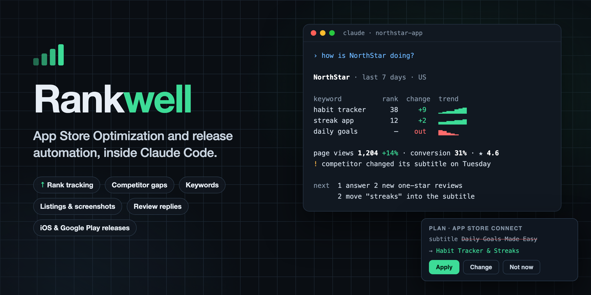
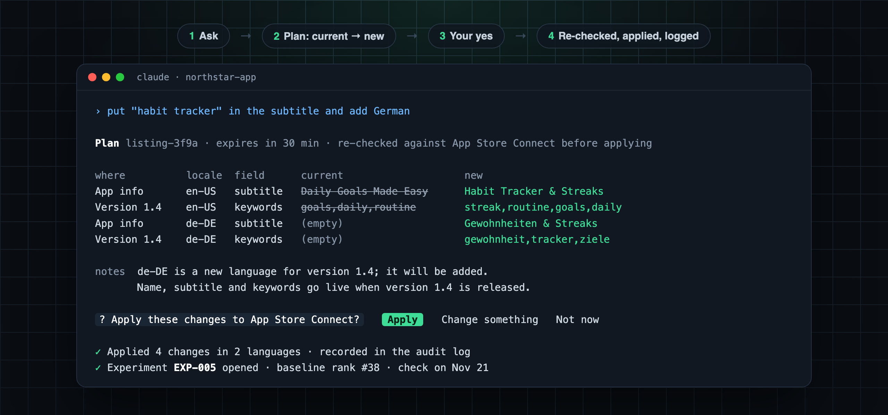
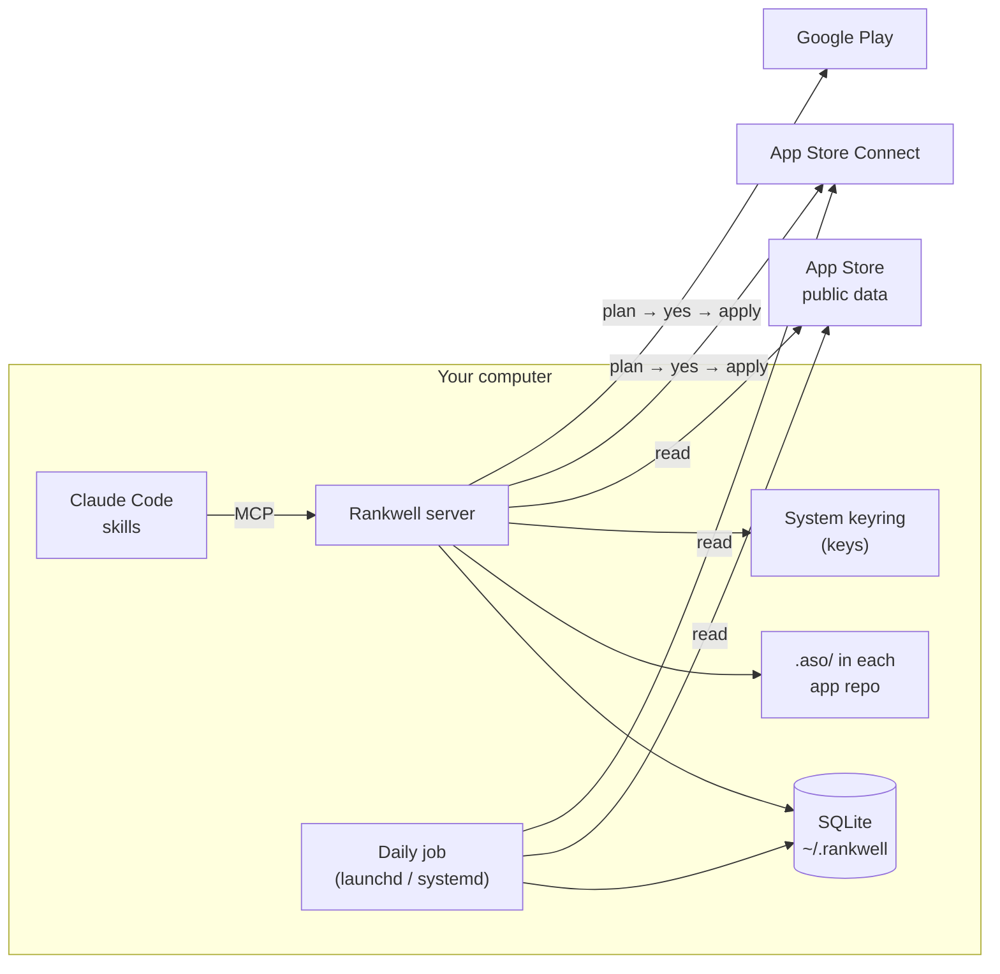

<div align="center">



<br>

[](https://github.com/AkashShahriar55/rankwell/actions/workflows/ci.yml) [](https://github.com/AkashShahriar55/rankwell/releases) [](LICENSE)    [](https://m8ven.ai/mcp/akashshahriar55/rankwell?s=readme)

**[Website](https://nimbusfold.com/rankwell/)** · **[Quick start](#quick-start)** · **[Step-by-step guide](https://medium.com/@akashshahriar55/how-to-automate-app-store-optimization-with-claude-code-step-by-step-687f1a2c1ebd)** · **[Skills](#skills)** · **[How it works](#how-it-works)** ·
**[Safety](#safety)** · **[Command line](#command-line)** · **[FAQ](#faq)**

</div>

---

**App Store Optimization and release automation for indie developers, inside Claude Code.**

Most ASO tools are dashboards you forget to open, and most release tools stop at the upload. Rankwell is a
[Claude Code](https://docs.anthropic.com/en/docs/claude-code) plugin that does both jobs where you already
write the code:

- **Watches.** A daily job tracks keyword ranks, your listing and your competitors', reviews, category charts
  and App Store Connect analytics, and keeps the history on your computer.
- **Advises with evidence.** Gap reports, keyword research and listing copy come with the numbers behind them
  and cite the ASO rule they follow.
- **Ships.** Listings, screenshots, review replies, builds, submissions and Google Play releases go out through
  a plan you approve in chat.
- **Remembers.** Decisions, experiments and progress live in a `.aso/` folder in each app repo, so the next
  session starts where the last one stopped.

> **Status:** early development (0.x). iOS App Store and Google Play. macOS and Linux (iOS builds need a Mac).

## Quick start

**1. Install the plugin**

```bash
claude plugin marketplace add AkashShahriar55/rankwell
```

```bash
claude plugin install rankwell@rankwell
```

**2. Restart Claude Code, open your app's repo and ask:**

```text
"Set up Rankwell for my app"
```

Setup checks the install, stores your App Store Connect key in the system keyring (you give the path of the
`.p8` file; its content never enters the chat), adds the app and its competitors, picks keywords and runs the
first collection.

New to it? The [step-by-step guide on Medium](https://medium.com/@akashshahriar55/how-to-automate-app-store-optimization-with-claude-code-step-by-step-687f1a2c1ebd) walks through setup, your first briefing, a
listing change and a release.

**3. Then just ask:**

```text
"How is my app doing?"
"What does my app lack against its competitors?"
"Which keywords should I target for a habit tracker?"
"Change the subtitle and add German"
"Upload the screenshots in ./shots"
"Reply to my one-star reviews"
"What should I change in the code before release?"
"Ship 1.4"
"The app got rejected under guideline 2.1"
"Upload the Android build to the internal track"
"Did the new subtitle work?"
```

**Requirements:** macOS or Linux, [uv](https://docs.astral.sh/uv/) (`brew install uv`, or
`curl -LsSf https://astral.sh/uv/install.sh | sh`), Xcode command line tools on a Mac for iOS builds, and an [App Store Connect API key](https://developer.apple.com/documentation/appstoreconnectapi/creating-api-keys-for-app-store-connect-api)
with the App Manager role. Public data (ranks, competitors, keywords) works without a key. Google Play needs a
service account with access to your apps.

<details>
<summary>Set up from a terminal instead</summary>

```bash
rankwell init --asc-key ~/Downloads/AuthKey_XXXXXXXXXX.p8 --issuer-id <issuer id>
```

```bash
rankwell schedule install --at 11:00
```

```bash
rankwell doctor
```

Inside Claude Code the command lives in the plugin folder; `rankwell install-cli` links it as
`~/.local/bin/rankwell` so it works in any terminal and survives plugin updates.

</details>

## See it work

Every change to your store listing is a plan you approve. Nothing is sent before your yes.



## Skills

Each skill is a playbook in [`skills/`](skills) that Claude follows step by step. You never call them by
name; just ask.

### Know where you stand

| Skill | What it does |
|---|---|
| [`aso-today`](skills/aso-today) | Daily briefing: what moved in ranks, ratings, reviews and competitors, and the next one to three actions |
| [`aso-stats`](skills/aso-stats) | Ranks, visibility, impressions, page views, downloads, conversion and charts over any period, as tables and sparklines |
| [`aso-gap`](skills/aso-gap) | Strengths and weaknesses against competitors with evidence: listing, ratings, keywords, complaints, estimated downloads |

### Grow

| Skill | What it does |
|---|---|
| [`aso-keywords`](skills/aso-keywords) | Ideas from autocomplete, App Store popularity, Google demand, difficulty and who owns the top 10 |
| [`aso-listing`](skills/aso-listing) | Name, subtitle, keywords, description, promo text and What's New: options, limit checks, one plan for many languages |
| [`aso-screenshots`](skills/aso-screenshots) | Checks sizes, transparency and count, then uploads, replaces and orders screenshots per device size |
| [`aso-experiment`](skills/aso-experiment) | Opens an experiment with a baseline when something changes, and judges it on its check date |

### Reviews and code

| Skill | What it does |
|---|---|
| [`aso-reviews`](skills/aso-reviews) | Finds unanswered low ratings, groups them by problem, drafts replies and posts them after your yes |
| [`aso-code-audit`](skills/aso-code-audit) | Audits the app repo: permission texts, rating prompt, display name, localizations, privacy manifest, deep links |

### Ship

| Skill | What it does |
|---|---|
| [`aso-ship`](skills/aso-ship) | Checks what Apple needs, builds (Flutter, Xcode, fastlane or your command), uploads, attaches, fills review info, submits |
| [`aso-review-fix`](skills/aso-review-fix) | Maps a rejection to the guideline, plans the fix and resubmits |
| [`aso-play`](skills/aso-play) | Google Play listing, .aab upload to a track with staged rollout, Play reviews and replies |

### Set up

| Skill | What it does |
|---|---|
| [`aso-setup`](skills/aso-setup) | Install check, key, app, competitors, keywords, first collection and the daily schedule |

## How it works



| Piece | What it does |
|---|---|
| **Skills** | Thirteen step-by-step playbooks Claude follows for setup, daily briefings, keywords, listings, screenshots, reviews, code audits, releases, rejections, Google Play and experiments |
| **MCP server** | About 60 tools. Every result carries a ready-to-show block of Markdown tables, sparklines and bars |
| **Daily job** | Ranks (top 200) for every tracked keyword, listings and their changes for you and your competitors, your reviews, category charts, App Store Connect analytics, and weekly Google demand. It catches up on missed days when your computer was asleep |
| **Storage** | Numbers in a local SQLite database; context, decisions, experiments and release settings as Markdown and TOML in each app repo, versioned with your code |
| **Knowledge** | Short ASO rules in [`knowledge/`](knowledge), cited by id in every recommendation. Add your own notes and they win when they disagree |

More detail in [docs/ARCHITECTURE.md](docs/ARCHITECTURE.md).

## Safety

Rankwell can change your live store listing, so every write follows the same rules:

1. **Plan first.** A `plan_*` tool reads the live state and shows current → new for every field. Nothing is
   sent yet.
2. **Your yes.** Claude asks; only your explicit approval applies the plan.
3. **Re-checked.** Before writing, the live state is read again. If anything changed since the plan was made,
   the plan is refused and you get a fresh one. Plans expire after 30 minutes.
4. **Logged.** Every change is recorded in an audit log you can read back ("what did Rankwell change?").
5. **No deletes.** The one exception is replacing screenshots of a version that is not live yet, and the old
   ones go only after the new ones finished processing.
6. **Google Play** changes are made in a single Play edit that is committed only when every step worked.

Keys live in the system keyring (the Keychain on macOS, GNOME Keyring or KWallet on Linux), never in files,
logs, the database or the chat. All data stays on your computer; there is no Rankwell server.

## Command line

The skills cover everything; the command line is for the terminal, CI and long uploads.

| Command | Does |
|---|---|
| `rankwell doctor` | Checks the setup and says what is missing |
| `rankwell collect [--app X]` | Runs the collection now |
| `rankwell schedule install \| uninstall \| status` | Manages the daily job |
| `rankwell ship <app> --step check \| build \| upload \| attach \| submit [--yes]` | iOS release steps |
| `rankwell screenshots upload <app> --locale en-US --folder shots/ [--yes]` | Uploads a screenshot set |
| `rankwell play upload <app> --track internal [--yes]` | Uploads an .aab to Google Play |
| `rankwell backup` | Writes a consistent copy of the database |

Run `rankwell --help` for every command and option.

## Data sources and limits

| Data | Source | Notes |
|---|---|---|
| Ranks, listings, charts | Apple's public Search, Lookup and RSS endpoints | Close to, not identical with, what the App Store shows |
| Keyword popularity | App Store autocomplete | A proxy, not search volume: how few letters people type before the term is suggested |
| Google demand | Google autocomplete and Google Trends | Best effort; compare with itself, not with App Store popularity |
| Analytics, your reviews | App Store Connect API | Official; analytics arrive one to two days late |
| Download estimates | Fitted on your own analytics and chart ranks | Always shown as a range with its data points; needs one of your apps to have charted |
| Google Play | Google Play Developer API | Your own apps only |

A weekly read-only check against Apple's live endpoints catches changes on Apple's side early. Known issue:
since November 2026 Apple's public review feed returns nothing to tools like Rankwell, so your own reviews come
from App Store Connect and competitor reviews are not refreshed.

## FAQ

**Does it work without an App Store Connect key?**
Yes, for ranks, competitors, keywords, charts and gap reports. Analytics, your reviews, listing changes and
releases need the key.

**Is my data sent anywhere?**
No. Rankwell talks only to Apple and Google. Your data stays in `~/.rankwell` and your repos.

**Can I use fastlane or my own build script?**
Yes. `.aso/release.toml` takes a Flutter, Xcode, fastlane or custom command for building and uploading.

**Does it work with Cursor or other agents?**
Yes, as an MCP server: `uv tool install "git+https://github.com/AkashShahriar55/rankwell@v0.2.3"`, then add
`{"command": "rankwell", "args": ["mcp"]}` to your client's MCP config. The step-by-step playbooks are written
for Claude Code skills but read fine as instructions in any agent. For listing copy without the server, use
the standalone skill in [`extras/app-store-listing-writer`](extras/app-store-listing-writer).

**Does it run on Linux?**
Yes. The daily job uses a systemd user timer (or cron when systemd is not available; cron cannot catch up
missed days), and keys go in GNOME Keyring or KWallet. On a server without a keyring, pass them as
environment variables (`RANKWELL_ASC_ISSUER_ID`, `RANKWELL_ASC_KEY_ID`, `RANKWELL_ASC_KEY_PATH`,
`RANKWELL_PLAY_KEY_PATH`). For the timer to run while you are logged out, run `loginctl enable-linger $USER`
once. Building and uploading iOS apps needs Xcode, so a Mac. Windows is not supported yet.

## Contributing

Issues and pull requests are welcome. Read [CONTRIBUTING.md](CONTRIBUTING.md) for the setup, the checks every
change must pass and how the code is organised. To report a security problem, follow
[SECURITY.md](SECURITY.md) instead of opening an issue.

## License

[MIT](LICENSE) © 2026 Akash Shahriar
